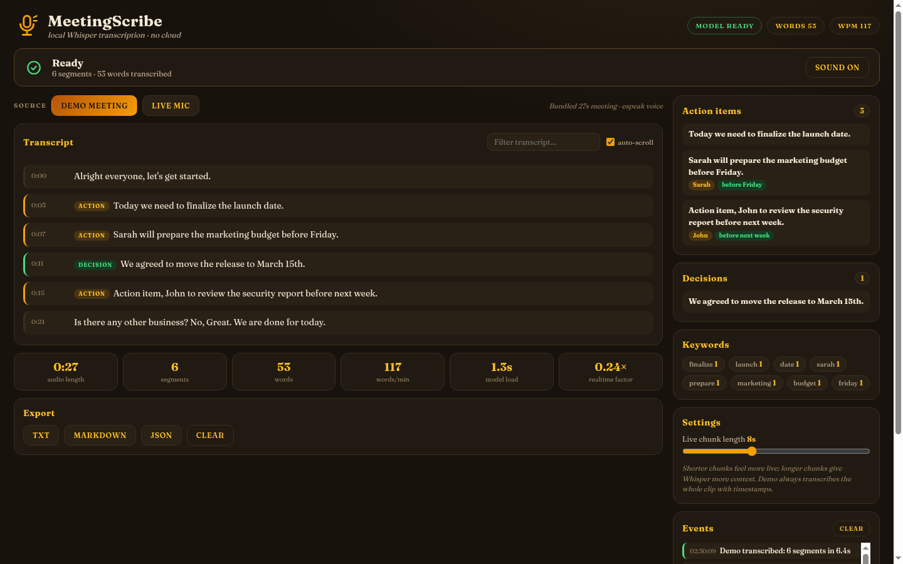
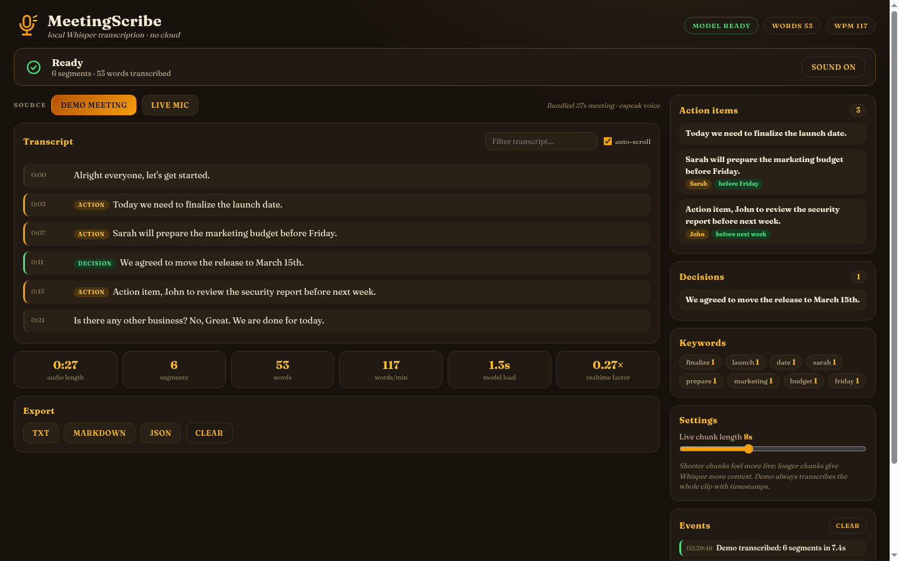
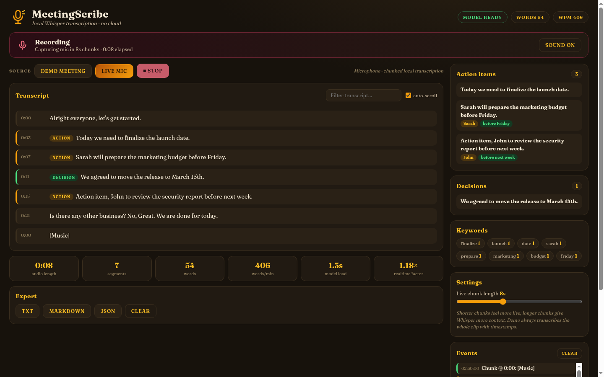
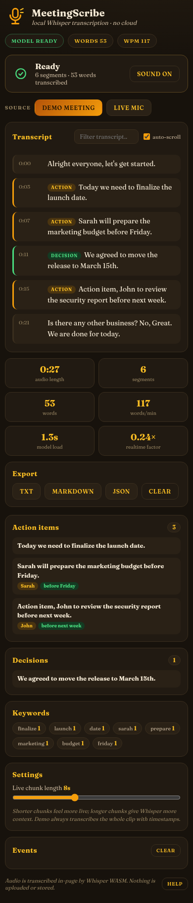

# MeetingScribe — Local Whisper Meeting Transcription

A Chrome extension that transcribes meetings **entirely on your device** using
OpenAI Whisper (tiny.en, quantized) running in WebAssembly via transformers.js.
No audio ever leaves the browser: the model, the ONNX Runtime WASM binaries and
the tokenizer are all bundled inside the extension.

Beyond raw transcription, MeetingScribe extracts **action items** (with owner
and deadline chips), **decisions**, and **keywords**, and exports the result as
TXT, Markdown (with checkboxes) or JSON.



## Features

- **100% local ASR** — Whisper tiny.en (quantized ONNX, ~40 MB) runs in-page via
  ONNX Runtime Web (WASM, SIMD). No server, no API key, no network access.
- **Demo meeting** — a bundled 27-second, 5-sentence meeting recording is
  transcribed automatically on first launch, with word-level timestamps.
- **Live microphone mode** — chunked recording (4–15 s adjustable chunks).
  Each chunk is decoded, resampled to 16 kHz mono and queued for local
  transcription while recording continues.
- **Insight extraction** — rule-based detection of action items, owners
  ("Sarah will…", "John to…"), deadlines ("before Friday") and decisions
  ("we agreed / decided / let's go with…").
- **Search & highlight** — filter the transcript with safe, escaped `<mark>`
  highlighting.
- **Exports** — plain TXT with timestamps, Markdown with action-item
  checkboxes, and structured JSON (segments, actions, decisions, keywords).
- **Live stats** — duration, segments, words, WPM, model load time and
  real-time factor (RTF = transcription time ÷ audio duration).
- **Notebook UI** — warm amber theme with the Fraunces serif typeface,
  responsive down to 390 px.

| Demo | Live mic | Mobile |
|---|---|---|
|  |  |  |

## How it works

```
mic / demo.wav ──► decodeAudioData ──► OfflineAudioContext (16 kHz mono)
        ──► Float32Array ──► Whisper tiny.en (ONNX, WASM SIMD, 1 thread)
        ──► text + timestamps ──► sentence classifier ──► transcript + insights
```

### ASR pipeline (`js/asr.js`)

- `transformers.js` 2.17.2 ESM bundle, vendored in `vendor/`.
- `env.allowRemoteModels = false`, `env.localModelPath = "models/"` — the
  pipeline can only load the bundled `Xenova/whisper-tiny.en` files.
- `env.backends.onnx.wasm.wasmPaths = "vendor/ort/"` — ORT WASM binaries are
  vendored; `numThreads = 1` because extension pages have no
  `SharedArrayBuffer`; SIMD enabled.
- Demo audio uses `return_timestamps: true` with `chunk_length_s: 30`,
  `stride_length_s: 5`; live chunks use `return_timestamps: false` (faster).

### Audio handling (`js/audio.js`)

- Any decoded audio is downmixed to mono (channel averaging) and resampled to
  16 kHz with an `OfflineAudioContext` — exactly Whisper's expected input.
- `MicRecorder` restarts a `MediaRecorder` (webm/opus) every chunk so each
  chunk is a self-contained decodable file. A serial promise queue keeps
  transcription ordered and never blocks capture.

### Insight extraction (`js/extract.js`)

| Kind | Trigger patterns (examples) | Extras |
|---|---|---|
| Action | "action item", "todo", "NAME will/to + verb", "need to", "must", "by/before <weekday>" | owner = capitalized name before will/to; deadline = weekday/date phrase |
| Decision | "we agreed/decided", "agreed to", "let's go with", "move/ship the release", "decision:" | — |
| Note | everything else | — |

Keywords are the top-8 frequency words after stop-word filtering.

## Honest limits

- **English only** — `whisper-tiny.en` is an English-only model. Other
  languages will produce garbage.
- **Tiny accuracy** — tiny is the smallest Whisper variant; expect occasional
  word errors, especially with accents, crosstalk or noisy rooms. Proper nouns
  may be misspelled.
- **Not real-time on slow CPUs** — RTF is shown in the stats panel; on a
  modest CPU a chunk can take longer to transcribe than to record. The queue
  keeps order but latency grows.
- **No speaker diarization** — segments are time-based, not speaker-based.
- **Demo voice** — the bundled meeting is synthesized with espeak-ng so the
  E2E test is deterministic; it sounds robotic by design.
- **Rule-based insights** — the extractor is pattern matching, not an LLM;
  phrasing outside the patterns above is logged as a note.

## Install (developer mode)

1. Clone or download this repository.
2. Open `chrome://extensions`, enable **Developer mode**.
3. **Load unpacked** → select the repository folder.
4. Click the MeetingScribe toolbar icon — the app opens in a tab and the demo
   meeting transcribes automatically once the model is ready.

Permissions: `storage` only (settings persistence). The microphone is requested
via `getUserMedia` only when you press **RECORD**.

## E2E test harness

Same harness as the sibling projects: headful Chromium under
`xvfb-run -a -s "-screen 0 1440x900x24"` driven by `puppeteer-core`, with
`--use-fake-device-for-media-stream --use-fake-ui-for-media-stream`,
`--enable-unsafe-swiftshader`, `--load-extension=<dir>`. Debug hooks are exposed
on `window.__ms`.

| Check | Result |
|---|---|
| Extension loads, service worker detected | pass |
| Whisper model loads locally (no network) | pass |
| Demo auto-transcribes: 6 segments, timestamps, 53 words | pass |
| Content check: sarah / friday / agreed / security / march / john | pass |
| Insights: ≥2 actions (owner+deadline chips), ≥1 decision | pass |
| Stats: duration ≈27 s, WPM, load time, RTF populated | pass |
| Search filters segments + highlights matches | pass |
| Chunk slider persists (4–15 s) | pass |
| Live mic: record → chunk pipeline → stop (fake device) | pass |
| TXT / Markdown / JSON export toasts | pass |
| Clear transcript, log clear, help modal | pass |
| Mobile 390 px: no horizontal overflow | pass |
| Console / page errors | none |

## Repository layout

```
manifest.json      MV3 manifest (storage only, wasm-unsafe-eval CSP)
background.js      toolbar click → opens app.html
app.html/css/      notebook UI (Fraunces, amber theme)
js/asr.js          transformers.js env config + Whisper pipeline
js/audio.js        16 kHz mono resampling + chunked MicRecorder
js/extract.js      action/decision/keyword extraction rules
js/app.js          state, queue, rendering, exports, debug hooks
vendor/            transformers.min.js + ONNX Runtime WASM binaries
models/            Xenova/whisper-tiny.en (quantized ONNX + tokenizer)
audio/             meeting-demo.wav (espeak-ng, 27 s)
icons/ docs/       extension icons, screenshots
```

## Credits & licenses

- Code: MIT (see `LICENSE`).
- [transformers.js](https://github.com/xenova/transformers.js) — Apache-2.0.
- [Whisper](https://github.com/openai/whisper) model weights (via
  [Xenova/whisper-tiny.en](https://huggingface.co/Xenova/whisper-tiny.en)) — MIT,
  © OpenAI.
- [ONNX Runtime](https://github.com/microsoft/onnxruntime) Web WASM — MIT.
- [Fraunces](https://fonts.google.com/specimen/Fraunces) — SIL OFL 1.1.
- Demo audio synthesized with [espeak-ng](https://github.com/espeak-ng/espeak-ng)
  (GPL-3.0); synthesized speech output is not covered by the GPL.